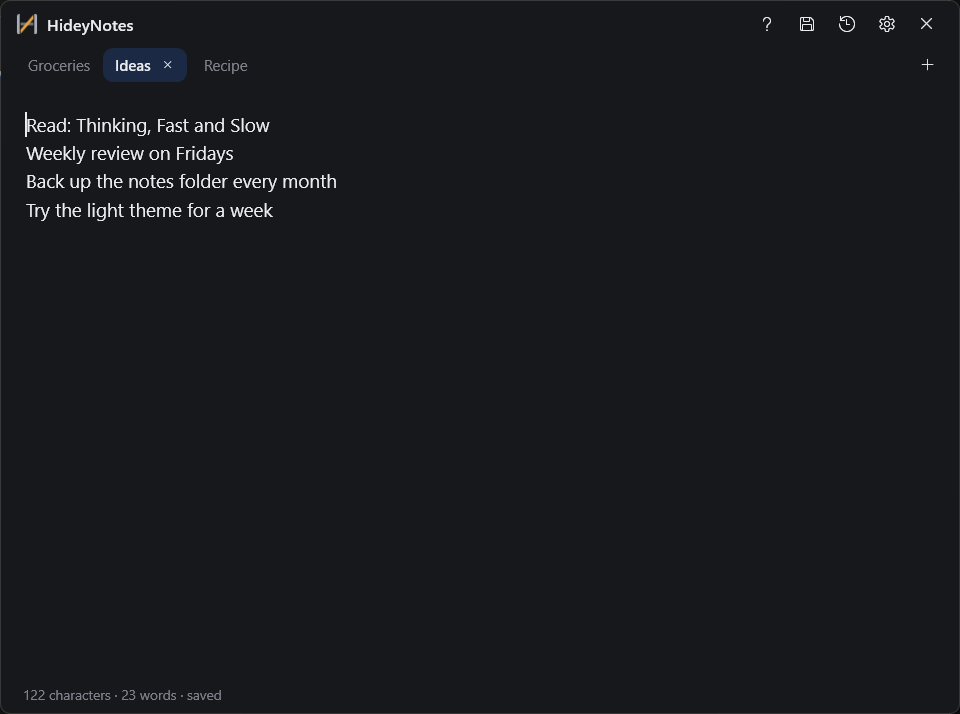
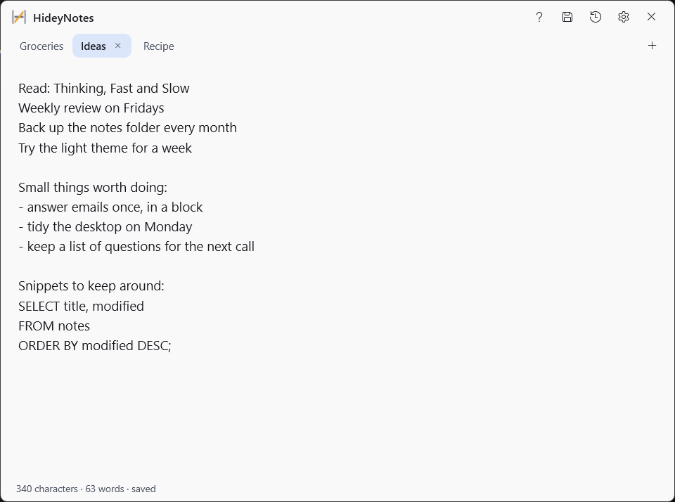
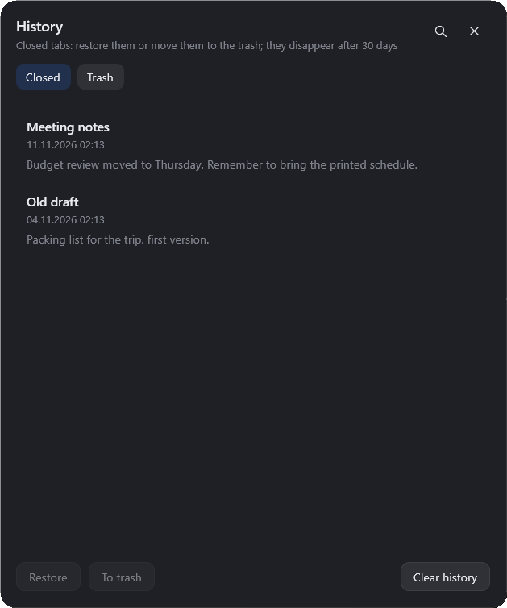

# HideyNotes

A slide-out notepad that lives at the right edge of the screen. One click (or one hotkey) and a
wide panel with all your tabs slides out, ready for quick notes.

Windows 10/11 · x64 · portable, no installer · no admin rights · MIT license

[English](#english) · [Русский](#русский)

| Dark theme | Light theme |
| :---: | :---: |
|  |  |

<p align="center"></p>

---

# English

## What it is

HideyNotes is a lightweight notepad for quick ideas, numbers, snippets and reminders that appear
out of nowhere. A small tab sits at the right edge of the screen; clicking it slides out a panel
with as many tabs as you need. Everything is saved as you type — no "save" button, no accounts,
no cloud, no background sync.

The panel is always on top and hides itself when it loses focus (the delay is adjustable), so it
never gets in the way of other windows.

## Features

- **Edge tab → slide-out panel.** 50% of the screen width and 70% of its height on any monitor
  (capped at 900 × 1000 DIP so it does not swallow half of a huge screen), with a 220 ms slide
  animation.
- **Unlimited tabs** with drag-to-reorder, inline rename and match counters during search.
- **Autosave.** Every tab is a plain `.txt` file under the data folder; drafts never get lost.
- **Search** inside the current note or across all tabs (`Ctrl+F`), with highlighting and a tab
  filter — and tab navigation follows the filtered tabs.
- **History and trash.** Closed tabs can be restored, moved to the trash or deleted; both lists
  keep notes for 30 days and highlight the last three. The history window has its own search.
- **Multi-monitor and per-monitor DPI.** The panel can follow the cursor or be pinned to a
  specific monitor and it adapts to that monitor's scaling.
- **Global hotkey** (`Ctrl+Shift+Space` by default, can be disabled).
- **Defaults to English, ships with Russian**, additional languages by dropping a JSON file.
- **Dark and light themes** following Windows, Mica backdrop on Windows 11.
- **Typography settings**: font, size, line spacing, padding, text color (swatches, hex input or
  the system color picker) — separately for dark and light theme.
- **Optional autostart** with Windows (per-user, no admin rights).

## Getting started

1. Download the latest ZIP from the **Releases** page and unpack it anywhere (or build it
   yourself, see below).
2. Run `HideyNotes.exe`. The app starts hidden: only a small tab at the right edge of the screen.
3. Click the tab — or press `Ctrl+Shift+Space` — and the panel slides out.
4. Type. The note is saved as you go; `Ctrl+S` exports it to a `.txt` file you choose.
5. To close: click outside the panel, press `Esc`, or use the × in the header (that hides it, it
   does not quit). To quit the app: tray icon → **Exit**, or `Ctrl+Q`.

The tray icon menu has *Show / hide*, *Settings* and *Exit*. In a restricted environment where
Windows refuses the tray icon, HideyNotes falls back to a normal taskbar window.

## Keyboard shortcuts

| Shortcut | Action |
| --- | --- |
| `Ctrl+Shift+Space` | show / hide the panel |
| `Esc` | close search or settings first, then hide the panel |
| `Ctrl+T` | new tab |
| `Ctrl+W` | close the tab (it goes to history) |
| `Ctrl+Shift+W` | close and forget (no history) |
| `Ctrl+Shift+T` | reopen the last closed tab |
| `Ctrl+Tab` / `Ctrl+Shift+Tab` | next / previous tab |
| `Ctrl+1…9` | jump to a tab by number |
| `Alt+1…9` or `Ctrl+Alt+1…9` | same, if `Ctrl+1` is taken by another app |
| `F2` or double click | rename the tab |
| `Ctrl+F` | search the current note; `Enter` / `F3` next match, `Shift+F3` previous; `Esc` closes the search |
| `Ctrl+Shift+F` | search every tab; with the search open the other shortcut switches the scope |
| `Ctrl+H` | history window; press again to close it |
| `Ctrl+F` in the history window | search closed notes and the trash |
| `Ctrl+S` | save the note as `.txt` (dialog) |
| `F1` | built-in help page |
| `Ctrl+Q` | quit the application |

Middle click on a tab closes it; tabs can be dragged with the mouse. While a search filters the
tab strip, tab shortcuts only walk through the visible tabs.

## Settings

Open them with the gear in the header (or the tray menu). Two pages:

**Text** — font family, size, line spacing, padding, text color for the current theme: pick a
swatch, type a hex color (`#RRGGBB` or `#AARRGGBB`) or choose one in the system palette dialog.

**Behavior** — hide delay on focus loss (never / at once / 300 ms / 1 s / 3 s), theme
(system / light / dark), interface language, monitor (auto or a specific screen), global hotkey
on/off, remember last search query, start with Windows.

## Languages

English and Russian are compiled into the executable; English is used on first run. The language
is switched in *Settings → Behavior → Language* and applied immediately, without a restart.

Any other language is a JSON file dropped into the `lang` folder of the data directory
(`%LOCALAPPDATA%\HideyNotes\lang\`). On the next start it appears in the language list — no code
changes, no rebuild:

```json
{
  "code": "de",
  "name": "Deutsch",
  "strings": {
    "panel.settings.title": "Einstellungen",
    "panel.font": "Schriftart",
    "help.text": "HideyNotes — schnelle Notizen am Bildschirmrand.\n..."
  }
}
```

- Translate only the keys you need: missing ones fall back to English (Russian is the last resort).
- The full key list is `Localization/Strings.ru.json`.
- A file with the code of a built-in language (`ru`/`en`) extends or overrides it.
- A broken or empty file is ignored and logged, so a bad translation never leaves the interface
  without text.
- Files are read at start-up; a new file needs a restart.

## Where the files live

By default everything is in `%LOCALAPPDATA%\HideyNotes\`:

| Path | Contents |
| --- | --- |
| `settings.json` | all settings, including the chosen language |
| `index.json` | tab order, active tab, history metadata |
| `notes\<id>.txt` | the notes themselves — one plain text file per note |
| `trash\*.json` | notes deleted from history (kept 30 days) |
| `lang\*.json` | extra interface languages |
| `log.txt` | errors only; the full diagnostic log is written when `HIDEYNOTES_LOG=1` is set |

If that folder is not writable (locked-down profile, sandbox), the app falls back to
`<exe folder>\HideyNotesData\` and then to `%TEMP%\HideyNotes\`.

Notes are ordinary `.txt` files, so they can be opened in any editor and the whole folder can be
copied as a backup. Nothing is sent anywhere: no telemetry, no network access at all.

## Building from source

Requires the .NET 10 SDK on Windows.

```
dotnet build HideyNotes.csproj -c Debug
```

Release build (self-contained, portable):

```
dotnet publish HideyNotes.csproj -c Release -r win-x64 --self-contained true ^
  -p:PublishSingleFile=true -p:EnableCompressionInSingleFile=true ^
  -p:IncludeNativeLibrariesForSelfExtract=false -o publish
```

The result is `publish\HideyNotes.exe` plus six native DLLs (WPF, D3D and the C++ runtime).
`IncludeNativeLibrariesForSelfExtract=false` keeps those DLLs next to the exe instead of unpacking
them into `%TEMP%` at start-up — that unpacking fails in environments where the temp folder is not
writable.

## License

MIT — see [LICENSE](LICENSE).

---

# Русский

## Что это

HideyNotes — лёгкий блокнот для быстрых мыслей, чисел, заготовок и напоминаний. У правого края
экрана висит маленький язычок; клик по нему выдвигает панель со всеми вкладками. Всё сохраняется
по мере набора: ни кнопки «сохранить», ни аккаунтов, ни облака, ни фоновой синхронизации.

Панель всегда поверх остальных окон и сама прячется при потере фокуса (задержка настраивается),
поэтому она не мешает работе.

## Возможности

- **Язычок у края → выдвижная панель.** 50% ширины и 70% высоты экрана на любом мониторе
  (с потолком 900 × 1000 DIP, чтобы панель не занимала пол-экрана на большом мониторе), выезд
  за 220 мс.
- **Неограниченное число вкладок**: перетаскивание для порядка, переименование, счётчик
  совпадений при поиске.
- **Автосохранение.** Каждая вкладка — отдельный `.txt` в папке данных, черновики не теряются.
- **Поиск** по текущей заметке или по всем вкладкам (`Ctrl+F`) с подсветкой и фильтром вкладок;
  переключение вкладок при этом ходит только по видимым.
- **История и корзина.** Закрытые вкладки можно вернуть, убрать в корзину или удалить; в обоих
  списках заметки живут 30 дней, последние три дня помечаются предупреждением. В окне истории
  есть свой поиск.
- **Мультимониторность и разный DPI.** Панель может следовать за курсором или быть закреплённой
  за конкретным экраном и подстраивается под его масштаб.
- **Глобальная горячая клавиша** (`Ctrl+Shift+Space` по умолчанию, можно отключить).
- **По умолчанию английский, русский в комплекте**, другие языки — одним JSON-файлом.
- **Тёмная и светлая темы** вслед за Windows, Mica-подложка на Windows 11.
- **Настройки типографики**: шрифт, кегль, межстрочный интервал, отступы, цвет текста (кружки,
  hex или системная палитра) — отдельно для тёмной и светлой темы.
- **Автозапуск с Windows** по желанию (для текущего пользователя, без прав администратора).

## Как начать

1. Скачай последний ZIP со страницы **Releases** и распакуй куда угодно (или собери сам, см. ниже).
2. Запусти `HideyNotes.exe`. Приложение стартует скрытым: у правого края экрана только язычок.
3. Нажми на язычок — или `Ctrl+Shift+Space` — панель выедет.
4. Пиши. Заметка сохраняется на ходу; `Ctrl+S` выгружает её в выбранный `.txt`.
5. Закрыть панель: клик мимо, `Esc` или крестик в шапке (это скрытие, не выход). Выйти из
   программы: значок в трее → **Выход** или `Ctrl+Q`.

В меню трея: *Показать / скрыть*, *Настройки*, *Выход*. Если Windows не разрешает значок в трее,
HideyNotes откатывается в обычное окно с кнопкой на панели задач.

## Горячие клавиши

| Клавиши | Действие |
| --- | --- |
| `Ctrl+Shift+Space` | показать / скрыть панель |
| `Esc` | сначала закрыть поиск или настройки, потом скрыть панель |
| `Ctrl+T` | новая вкладка |
| `Ctrl+W` | закрыть вкладку (уходит в историю) |
| `Ctrl+Shift+W` | закрыть и забыть (без истории) |
| `Ctrl+Shift+T` | вернуть последнюю закрытую |
| `Ctrl+Tab` / `Ctrl+Shift+Tab` | следующая / предыдущая вкладка |
| `Ctrl+1…9` | перейти к вкладке по номеру |
| `Alt+1…9` или `Ctrl+Alt+1…9` | то же, если `Ctrl+1` занят другим приложением |
| `F2` или двойной клик | переименовать вкладку |
| `Ctrl+F` | поиск в текущей заметке; `Enter` / `F3` — следующее совпадение, `Shift+F3` — предыдущее, `Esc` — закрыть |
| `Ctrl+Shift+F` | поиск по всем заметкам; при открытом поиске другая комбинация переключает область |
| `Ctrl+H` | окно истории; повторное нажатие закрывает |
| `Ctrl+F` в окне истории | поиск по закрытым заметкам и корзине |
| `Ctrl+S` | сохранить заметку в `.txt` (диалог) |
| `F1` | встроенная справка |
| `Ctrl+Q` | выйти из программы |

Средний клик по вкладке закрывает её; вкладки можно перетаскивать мышью. Пока поиск фильтрует
полосу вкладок, горячие клавиши переключения ходят только по видимым вкладкам.

## Настройки

Открываются шестерёнкой в шапке (или из меню трея). Две страницы:

**Текст** — шрифт, кегль, межстрочный интервал, отступы, цвет текста для текущей темы: кружок из
палитры, hex (`#RRGGBB` или `#AARRGGBB`) или системный диалог выбора цвета.

**Поведение** — задержка скрытия при потере фокуса (никогда / сразу / 300 мс / 1 с / 3 с), тема
(системная / светлая / тёмная), язык интерфейса, монитор (авто или конкретный экран), глобальная
горячая клавиша вкл/выкл, помнить последний запрос поиска, запускать при входе в Windows.

## Языки

Английский и русский зашиты в exe, при первом запуске используется английский. Язык
переключается в *Настройки → Поведение → Язык* и применяется сразу, без перезапуска.

Любой другой язык — это JSON-файл в папке `lang` папки данных
(`%LOCALAPPDATA%\HideyNotes\lang\`). После следующего запуска он появляется в списке языков —
без правок кода и пересборки:

```json
{
  "code": "de",
  "name": "Deutsch",
  "strings": {
    "panel.settings.title": "Einstellungen",
    "panel.font": "Schriftart",
    "help.text": "HideyNotes — schnelle Notizen am Bildschirmrand.\n..."
  }
}
```

- Переводить можно только нужные ключи: недостающие берутся из английского, русский — последний
  резерв.
- Полный список ключей — `Localization/Strings.ru.json`.
- Файл с кодом встроенного языка (`ru`/`en`) дополняет или перекрывает его.
- Битый или пустой файл игнорируется и пишется в лог, так что плохой перевод никогда не оставит
  интерфейс без текста.
- Файлы читаются при запуске; для нового файла нужен перезапуск.

## Где лежат файлы

По умолчанию всё в `%LOCALAPPDATA%\HideyNotes\`:

| Путь | Что внутри |
| --- | --- |
| `settings.json` | все настройки, включая выбранный язык |
| `index.json` | порядок вкладок, активная вкладка, метаданные истории |
| `notes\<id>.txt` | сами заметки — один обычный текстовый файл на заметку |
| `trash\*.json` | заметки, удалённые из истории (хранятся 30 дней) |
| `lang\*.json` | дополнительные языки интерфейса |
| `log.txt` | только ошибки; полный диагностический лог пишется, если задать `HIDEYNOTES_LOG=1` |

Если папка недоступна для записи (закрытый профиль, песочница), приложение откатывается в
`<папка с exe>\HideyNotesData\`, затем в `%TEMP%\HideyNotes\`.

Заметки — обычные `.txt`, их можно открыть любым редактором, а всю папку скопировать как бэкап.
Наружу ничего не уходит: ни телеметрии, ни сетевых запросов.

## Сборка из исходников

Нужен .NET 10 SDK на Windows.

```
dotnet build HideyNotes.csproj -c Debug
```

Релизная сборка (self-contained, портативная):

```
dotnet publish HideyNotes.csproj -c Release -r win-x64 --self-contained true ^
  -p:PublishSingleFile=true -p:EnableCompressionInSingleFile=true ^
  -p:IncludeNativeLibrariesForSelfExtract=false -o publish
```

На выходе `publish\HideyNotes.exe` и шесть нативных DLL (WPF, D3D и C++ runtime).
`IncludeNativeLibrariesForSelfExtract=false` оставляет их рядом с exe вместо распаковки в `%TEMP%`
при старте — распаковка падает там, где временная папка недоступна для записи.

## Лицензия

MIT — см. [LICENSE](LICENSE).
